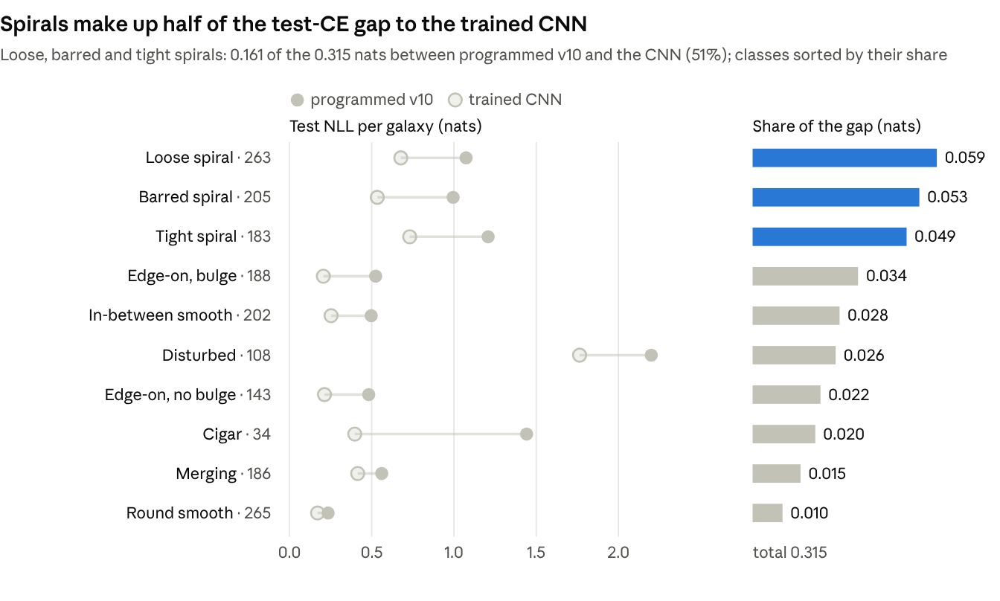

# A Hand-Programmed CNN for Galaxy10 DECaLS

November 2026

A 475,161-parameter convolutional network whose every weight was written by Claude from closed-form statistics, with no gradient step anywhere, scores test cross-entropy 0.804 (73.7% accuracy) on 10-class Galaxy10 DECaLS. A gradient-trained CNN of the same size scores 0.489 (82.4%), so the programmed network covers about 82% of the gap between a class-prior guess and the trained network.

## Results

On the sealed test split (1,777 galaxies, scored once), the programmed network reaches cross-entropy 0.804, against 2.220 for the prior and 0.489 for the trained CNN: (2.220 − 0.804) / (2.220 − 0.489) = 82% of the gap closed.

| Model | Parameters | Where the weights come from | Val CE | Val acc. | Test CE | Test acc. | Test ECE |
| --- | --- | --- | --- | --- | --- | --- | --- |
| Class prior | 10 | training-set class frequencies | 2.219 | 14.9% | 2.220 | 14.9% | 0.000 |
| **Programmed CNN (v10)** | 475,161 | written by Claude: closed-form statistics, 49 harness passes | 0.794 | 74.4% | **0.804** | **73.7%** | 0.036 |
| Trained CNN baseline | 476,346 | AdamW, 30 epochs, augmentation, best-val epoch, fitted temperature | 0.477 | 83.4% | 0.489 | 82.4% | 0.020 |

The val-to-test gap is 0.009 for the programmed network and 0.012 for the CNN, so neither overfit its val selection noticeably. The programmed network is slightly overconfident on test (mean top probability 0.750 against 73.7% accuracy).

## Setup

The question was whether a frontier model can write a working image classifier's weights directly, as in "Sparks of Weight-Space Programming" (Takehi et al., MIT CSAIL, 2026), on a perception task instead of a language model.

**Task.** Galaxy10 DECaLS: 17,736 colour images (256 × 256 px) in 10 morphology classes, from Disturbed (1,081 images) to Round smooth (2,645) and Cigar-shaped (334). The score is mean cross-entropy (natural log); lower is better. The challenge notebook's split (seed 1234) gives 14,187 train, 1,772 val and 1,777 test images.

**Rules**, enforced by the harness [`galaxy/wsp.py`](galaxy/wsp.py), the only code that ever runs the network:

1. The network is an `nn.Sequential` of whitelisted layers (Conv2d, Linear, ReLU, AvgPool2d, MaxPool2d, adaptive pools, Flatten), so `forward()` is fixed and every behaviour lives in the weights.
2. Fewer than 500,000 numbers in the state_dict. Input is the notebook's (B, 3, 256, 256) float in [0, 1]; output is 10 logits.
3. No gradients and no loss fitting: no backprop, least squares, logistic regression or search over weights against a score. Closed-form statistics of activations are allowed: means, covariances, quantiles, eigenvectors, LDA and QDA.
4. Budget of 50 passes. An `acts` call (activations after layer K, on training images) or a `val` call (summary scores on val) costs one pass each.
5. Val is seen only through `val`'s summary numbers (cross-entropy, accuracy, calibration, per-class NLL and recall, confusion matrix). Test is seen only through `final`, run once on the submitted network.

**Editor.** Claude, in a Claude Code session, wrote numpy scripts ([`galaxy/editor/v1.py`](galaxy/editor) … `v10.py`) that build each network's weights from earlier passes' activations. It could look at training images, but never ran the network or computed image features outside the harness. 49 of 50 passes were used, and `final` ran once, on v10.

## Architecture

The network is a fixed 21-layer pipeline. The first 9 layers turn the image into 151 hand-designed measurements; the remaining 12 apply a log transform and a closed-form quadratic classifier. Only 134,548 of the 475,161 numbers (28%) are nonzero, and 66% of the budget sits in one layer: the per-measurement weight maps.

| Layers | Module | Output | What the weights compute | Parameters (nonzero) |
| --- | --- | --- | --- | --- |
| 0 | AvgPool2d(4) | 3 × 64 × 64 | downsample 256 → 64 px | 0 |
| 1–2 | Conv2d(3→76, 13×13) + ReLU | 76 × 52 × 52 | 76 base filters: luminance L, red R, blue B; fine and coarse band-pass (HPf, HPc) per band; derivatives at 0/60/120°; bar-scale ring kernels; threshold filters for areas and masks. Biases subtract the sky level plus 2–3 noise sigmas measured in pass 1 | 38,608 (9,095) |
| 3 | AvgPool2d(2, padding=1) | 76 × 27 × 27 | 27 × 27 map, 8 px per cell, with cell (13, 13) centred on the galaxy | 0 |
| 4 | Conv2d(76→430, 1×1) | 430 × 27 × 27 | copy each base map to the measurement channels that use it; sum the 5 bar projections; form soft masks as clamp = a − b | 33,110 (473) |
| 5–6 | Conv2d(430→430, 27×27, groups=430) + ReLU | 430 × 1 × 1 | one weighted integral per channel over the whole map (a disk, annulus, Gaussian window, moment, Fourier mode or cell-pair difference), then its positive part | 313,900 (108,197) |
| 7–8 | Conv2d(430→151, 1×1) + ReLU | 151 | sum channels into the 151 features | 65,081 (430) |
| 9–11 | grouped 1×1 convs + ReLU | 151 | piecewise-linear log of each feature, 14 knots placed at its training quantiles | 6,493 |
| 12–14 | grouped 1×1 convs + ReLU | 302 | u = rescaled log in [0, 1] and u² from an 8-knot staircase | 5,134 |
| 15 | Conv2d(302→9, 1×1) | 9 | project onto the 9 whitened LDA directions z | 2,727 |
| 16–18 | Conv2d(9→864) + ReLU + Conv2d(864→54, groups=54) | 54 | 16-knot staircases for zᵢ² and (zᵢ + zⱼ)², plus zᵢ itself | 9,558 |
| 19–20 | Flatten + Linear(54→10) | 10 | QDA log-posteriors (temperature 0.65) | 550 |

The layout is a packing problem. A channel in layer 5 costs about 912 numbers (a 729-number map, its copy row and its feature column), so every design choice is priced in channels. The odd 52 → 27 geometry exists so that one map cell sits exactly on the galaxy centre. In v5 the centre fell between cells, and the bar measurements lost 9 points of barred recall until v5c fixed it.

## Programming primitives

Every nonlinear quantity is built from ReLUs placed where a linear read can use them. Six constructions carry the whole design.

**1. Orientation-free magnitudes.** A galaxy's elongation, bar strength or spiral mode is a 2-vector v (the complex amplitude of an m-fold pattern) whose direction is random. Its length comes from the positive parts of projections onto N directions. Projection j is one channel whose weight map is w(r) cos(mθ − φⱼ):

```math
|v| \approx \frac{1}{N} \sum_{j=1}^{N} \mathrm{relu}(v \cdot e_j), \qquad \varphi_j = 2\pi j / N
```

With N odd, no direction is another's opposite, so the sum equals half of Σ|v · eⱼ| over 2N half-directions. The rotation ripple is 1 / cos(π / 2N): 5.1% for N = 5, against 8.2% for N = 8. Switching from 8 to 5 directions in v10 saved 3 channels per magnitude and also reduced the error.

**2. Clamps (areas and masks).** Two filters with the same kernel and biases one apart give a soft step:

```math
\mathrm{clamp}(k(x - t), 0, 1) = \mathrm{relu}(k(x - t)) - \mathrm{relu}(k(x - t) - 1)
```

Summed over pixels, it is the area above threshold t: isophotal areas at 3–45 sky-noise sigmas, clump coverage, and the detection mask used for shape asymmetry.

**3. Sums of absolute differences (asymmetry).** 180° asymmetry is Σ|I(x) − I(−x)| over cell pairs. Since |x| = 2 relu(x) − x:

```math
\sum_p |x_p| = 2 \sum_p \mathrm{relu}(x_p) - \mathrm{relu}(S) + \mathrm{relu}(-S), \qquad S = \sum_p x_p
```

This needs one channel per pair plus two, instead of two per pair; v10 used it to cut 52 channels with identical outputs.

**4. Log transform.** Each feature x goes through a piecewise-linear log with knots tₖ spaced geometrically between its 0.5% and 99.5% training quantiles:

```math
\log x \approx \log t_0 + \sum_k (s_k - s_{k-1})\, \mathrm{relu}(x - t_k)
```

Here sₖ is the secant slope between knots. In log space, ratios such as colours, concentrations and normalised amplitudes become linear, which the linear and quadratic heads can use directly.

**5. Squares.** u² on [0, 1] and the QDA terms zᵢ² and (zᵢ + zⱼ)² come from ReLU staircases that interpolate the parabola at evenly spaced knots, on both signs for z.

**6. Offsets.** A large bias before a ReLU (+25 in v5b) keeps it from clipping, and the linear read after it subtracts the offset again. It let a filter skip the first ReLU. v10 no longer needs it: the bar projections are clipped at the first ReLU and summed by the copy layer.

## Measurements

v10 computes 151 features from 430 layer-5 channels, all chosen from astronomy's standard morphology measures plus diagnostics on training activations. Radii are in map cells (1 cell = 8 original px); σ is the sky noise measured in pass 1.

| Family | Features | Channels | What it measures | Classes it targets | Added |
| --- | --- | --- | --- | --- | --- |
| Asymmetry | 6 | 105 | 180° asymmetry of L (inner pixel pairs, outer 4×4 cells), inner B and HPc, plus shape asymmetry: the asymmetry of a deep, smoothed 1.5σ detection mask, and the mask's area | disturbed, merging | ≤ v5; shape v9; B, HPc v10 |
| Fourier modes of the arm map | 11 | 47 | m = 1, 2, 3 amplitudes of coarse band-pass HPc in core (1–2.5), inner (2–5) and outer (5–10) annuli; annulus fluxes | spirals, disturbed | v6; core v10 |
| Log-spiral amplitudes | 4 | 40 | \|A(2, p)\| + \|A(2, −p)\| for p = 2.5, 4.5, 7.5, 12 (pitch 39° to 9.5°): the log-polar Fourier transform used to measure arm pitch | tight vs loose | v9 |
| Radial profiles | 40 | 40 | HPf, HPc (each on L, R, B), R and B light in 5 annuli (0–1.5, 1.5–3, 3–5, 5–8, 8–12): colour gradients, colour and placement of clumps and arms | tight vs loose, edge-on | v10 |
| Gaussian-window shape | 14 | 30 | second-moment elongation, size (r²-weighted) and flux in Gaussian windows, σ = 1.5 to 9 | smooth classes, cigar, edge-on | ≤ v5 |
| m = 1 lopsidedness | 5 | 25 | dipole of L (σ = 4, 9 windows), of HPc, and of B in two annuli | disturbed | ≤ v5; B v10 |
| Ring m = 2 and turn | 12 | 44 | m = 2 amplitude of L in 4 log-spaced rings, ring fluxes, and \|vₐ ± v_b\| between adjacent rings (isophote twist) | barred, spirals, edge-on | ≤ v5 |
| Light distribution | 15 | 20 | Gini / M20-style: isophotal area, flux above threshold, r²-spread of that flux at 3, 6, 12, 24, 45σ | merging, disturbed, concentration | v7 |
| Band areas | 11 | 22 | area above threshold for HPc (3, 6, 12σ), B and R (3, 8, 20σ), HPf (6, 12σ) | arm coverage, blue disk vs red bulge extent | v8; HPf v10 |
| Aperture fluxes | 19 | 19 | L in 7 disks (r = 1.5 to 13.5), R, B, HPf and HPc in 3 disks each | brightness, concentration, colour | ≤ v5 |
| Edge orientation | 6 | 18 | radial vs tangential derivative energy in 3 annuli | arms, rings, disks | ≤ v5 |
| Isophote alignment | 3 | 15 | inner vs outer elongation combined as \|m₁ ± c · m₂\| | bulge vs disk, edge-on with bulge | ≤ v5 |
| Bar (centre, 64-px resolution) | 5 | 5 | m = 2 ring kernels at 2–3 and 3–4.5 px, their turn ±, and fine elongation, read at the exact centre; 25 first-layer filters | barred | v5b; merged v9 |

The first-layer ReLU makes each filter one-sided: it keeps light above sky + 2σ for L, R and B, and structure above 3σ for the band-passes. So every feature measures detected light or detected structure, and pure noise contributes almost nothing.

## Classifier head

The head is a regularised quadratic discriminant (QDA) in the 9 LDA directions, and every number in it comes from class means and covariances of the training activations. On the same v6 features, it beat a linear (LDA) head by 0.040 in val CE: 0.935 → 0.895.

1. From the 302 u and u² columns (pass 48), compute class means μ_c, class covariances Σ_c and the pooled within-class covariance S_w, shrunk 10% toward its diagonal.
2. Whiten with the Cholesky factor of S_w and take the 9 leading eigenvectors of the between-class scatter (10 classes give rank 9). Layer 15 computes z = Vᵀ(u − ū), with Vᵀ S_w V = I.
3. Blend each class covariance toward the pooled one and score:

```math
\tilde\Sigma_c = (1-\alpha) V^\top \Sigma_c V + \alpha I, \qquad \ell_c = T\left[-\tfrac{1}{2}(z - m_c)^\top \tilde\Sigma_c^{-1}(z - m_c) - \tfrac{1}{2}\log\det\tilde\Sigma_c\right] + \log \pi_c
```

4. Rewrite the quadratic form with zᵢzⱼ = ½[(zᵢ + zⱼ)² − zᵢ² − zⱼ²]. The logits then become linear in 9 + 36 squared quantities and 9 linear terms (54 inputs). Layers 16–18 build the squares from ReLU staircases (8 knots per side, out to the largest class mean plus 4 sd), and layer 20 holds the coefficients.

α = 0.5 and T = 0.65 were picked with val passes on v6 and v8 (α from 0.3 to 0.7, T from 0.65 to 1.0, 10 passes in all), then frozen for v9 and v10. Two variants did not help:

- α = 0.3 at T = 1 was badly overconfident (val CE 0.996).
- Adding 6 more directions where the class spreads differ tied at 0.897 once the 9 LDA directions were protected, and fell to 1.004 when they were not.

## Development history

Val CE fell from 1.174 to 0.794 over 12 versions and 49 passes. The biggest steps were the QDA head (v6) and the v10 repack-and-spend round (−0.060). v1–v4 exceeded the 500,000 limit, because it was first read as 30M and later corrected, so v5 is the first valid network. From v5 on, each version used 2 `acts` passes (raw features for the log knots, then the u/u² activations for the head) and at least one `val`. Every pass is in [`galaxy/runs/r1/log.jsonl`](galaxy/runs/r1/log.jsonl).

| Version | Passes | Parameters | Val CE | Val acc. | What changed |
| --- | --- | --- | --- | --- | --- |
| v1 | 1–4 | 3,517,836 | 1.174 | 60.9% | Dense Linear over a 32 × 32 map: aperture fluxes, band-pass energies, windowed moments, pixel-pair asymmetry; piecewise-linear log; LDA. Pass 1 measured sky levels and noise. |
| v2 | 5–9 | 15,441,011 | 1.054 | 65.2% | 64 × 64 map; moments at 5 window sizes and their alignment; m = 1; band-pass asymmetry; first log-spiral templates; u² terms; temperature 0.8. |
| v3 | 10–12 | 19,192,797 | 0.969 | 69.4% | Dropped the spiral templates (tight/loose separation only 0.15 sd on train); added ring-to-ring m = 2 winding. |
| v4 | 13–17 | 25,675,731 | 0.939 | 69.3% | Derivative-of-Gaussian edge orientation, radial vs tangential; temperature 0.7. |
| v5 | 18–20 | 404,885 | 0.983 | 67.5% | Repacked under 500k: one channel and one full-map weight map per measurement (grouped conv). |
| v5b | 21–23 | 414,130 | 0.983 | 67.4% | +25 offsets on the bar kernels so the first ReLU does not clip; finer bar rings. No gain. |
| v5c | 24–26 | 430,657 | 0.958 | 68.9% | 29 × 29 map with a cell exactly on the galaxy centre. The real cause of v5's lost bar signal was an off-centre read. |
| v6 | 27–35 | 432,877 | 0.895 | 71.1% | Each filter computed once and copied by a 1 × 1 layer (~65k freed); HPc m = 1, 2, 3 modes; QDA head. |
| v7 | 36–38 | 470,447 | 0.876 | 71.3% | Gini / M20-style light distribution at 5 thresholds. |
| v8 | 39–43 | 490,984 | 0.863 | 71.7% | 27 × 27 map with a 13 × 13 first conv (~30k freed); areas of HPc, B, R; α = 0.5, T = 0.65. |
| v9 | 44–46 | 491,677 | 0.854 | 72.2% | Log-polar spiral amplitudes; shape asymmetry; bar projections merged in the copy layer; 72 low-value channels dropped. |
| v10 | 47–49 | 475,161 | 0.794 | 74.4% | 5-direction magnitudes and the 2 relu(x) − x asymmetry (~150k freed); radial colour and fine-structure profiles; blue m = 1; inner B and HPc asymmetry. |

Between passes, the editor chose cuts and additions from free closed-form diagnostics on the training activations already returned: class-pair Mahalanobis distances and their change when a feature group is removed, per-feature d′, and split-half checks. None of these touched val or test.

## Per-class comparison



*Test split, 1,777 galaxies. Per-class NLL from the harness's final run and [`galaxy/runs/baseline_cnn/scores.json`](galaxy/runs/baseline_cnn/scores.json); share = NLL difference × class count / 1,777.*

Cigar has the widest per-galaxy gap but only 34 test galaxies, and 10 of its errors go to edge-on with bulge. Disturbed is hard for both networks: each finds 25% of them. The largest single confusion for the programmed network is tight spirals called loose (51 of 183).

## What worked and what didn't

Closed-form diagnostics on training activations were a reliable guide. The two latest rounds raised the held-out class-pair separation by 2.2% (v9) and 7.5% (v10), and val CE then fell by 0.009 and 0.060.

Worked:

- **Standard morphology measures as features.** Asymmetry, Gini / M20-style areas, colour profiles and band-pass structure each lowered val CE when added.
- **Packing.** One weight map per measurement took v4's 25.7M dense numbers to 405k (v5). Shared filters and a copy layer (v6), the 27 × 27 map (v8), and 5-direction magnitudes with the |x| identity (v10, ~150k) each paid for the next round of features.
- **Exact centring.** Moving to a map with a cell on the galaxy centre (v5c) brought back the bar signal that v5 had lost.
- **QDA over LDA.** −0.040 val CE on the same features.

Did not work:

- **Spiral pitch.** Spiral templates were tried twice: on the 64-px map in v2, and in log-polar form in v9. The tight/loose separation on train moved only from 1.84 to 1.86, and about 50 tight spirals were called loose in every version. Ring-to-ring winding wraps for tight arms (a 3.8 rad turn at 12°), and 8-px cells are too coarse to follow them.
- **Disturbed galaxies.** Test NLL stayed near 2.0 in every version, and recall is 25% on test, the same as the trained CNN's.
- **Small fixes.** Offsets (v5b), extra QDA directions (v6), and α / T tweaks moved val CE by 0.002 or less, or made it worse.

## Limitations and caveats

The headline number is a fair single test score, but four things limit what it shows.

- **Val was the editor's feedback.** 23 `val` passes chose designs and head settings, so val CE (0.794) is optimistic. The 0.009 val-to-test gap suggests the leak is small, and the trained CNN also chose its epoch and temperature on val.
- **No control yet.** A run with random filters and the same closed-form head has not been done, so it is untested how much of the 82% comes from the programmed measurements rather than the head.
- **One run against one baseline.** A single editor session, one split and one seed. The CNN baseline is a single configuration (30 epochs, no search), so a tuned CNN would widen the gap.
- **What "programmed" means.** Claude designed every computation and derived each number from statistics, by writing numpy scripts that emit the weights; it did not type the 475k numbers one by one. The no-loss-fitting rule was kept: knots, LDA and QDA are closed-form. Choosing among val passes is still a search against a score, capped by the 50-pass budget.

## Reproduction

The submitted network is [`galaxy/runs/r1/submission/`](galaxy/runs/r1/submission) (`submission.pt` + `arch.json`, hash 3b44c7e80ec74d48). See the [README](README.md) for setup and the commands that rebuild it from the two activation files included in this repo.
